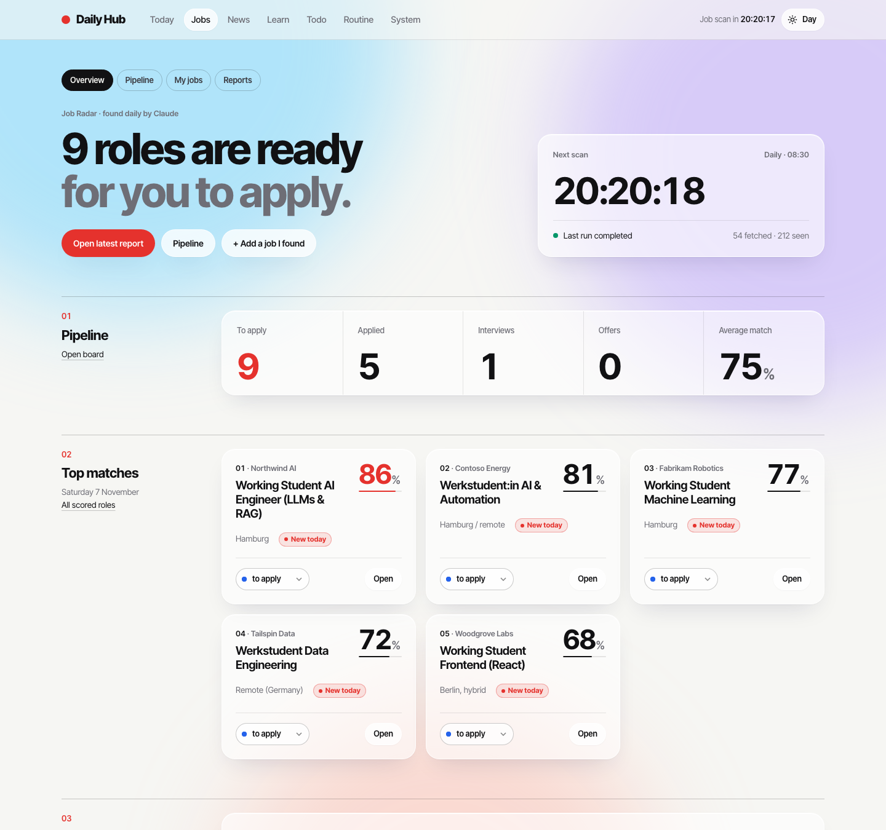
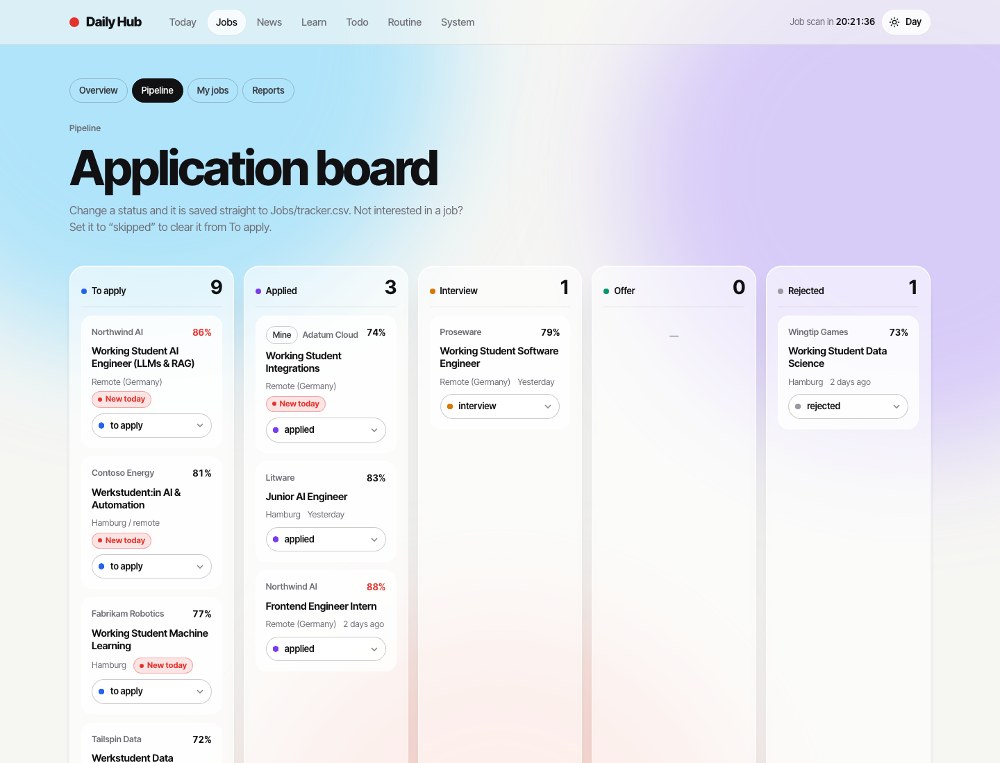
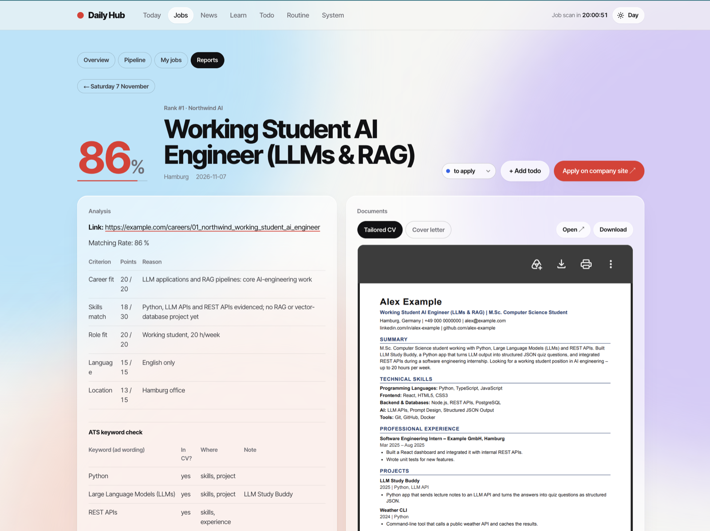
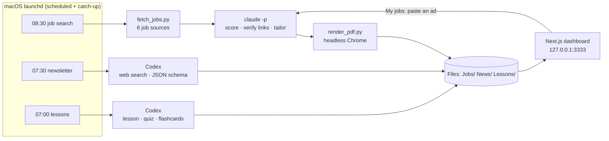

# Daily Hub

A personal automation platform that runs on a Mac every morning. Before the day starts, it has:

- **found and scored new jobs** from six sources, and written a tailored CV and cover letter for the best five,
- **written an AI newsletter** with links to the day's most useful AI releases and projects,
- **prepared a study lesson**, quiz and flashcards for each learning track.

Everything shows up in a local Next.js dashboard, together with an application pipeline, todos and habits.

Built by [Ramazan Alkoyun](https://github.com/Resan-ramazan), M.Sc. Artificial Intelligence student. Developed AI-first: the code was written together with coding agents (Claude Code), and the system itself orchestrates LLM agents.

| Application pipeline | Job analysis with tailored CV |
|---|---|
|  |  |

Screenshots use fictional demo data (`python3 docs/make_demo_data.py`): the candidate "Alex Example" and Microsoft's sample company names.

## How it works

### Job search (`automation/`)
1. **Collect.** `fetch_jobs.py` reads the Arbeitnow API and the companies' own applicant tracking systems (Greenhouse, Lever, Ashby, Personio and Recruitee APIs; the company list is `profile/companies.json`). It keeps student, junior and entry-level roles in Germany, drops ads that ask for 3+ years of experience, and removes duplicates. Postings from a company's own system are live originals, so no dead links.
2. **Score.** A Claude agent (`daily_prompt.md`) adds web-search results, verifies every link on the company's own page, and scores each job on a 100-point rubric: career fit, must-have skills, role type, language and location.
3. **Tailor.** For the top five it writes a CV and a cover letter from the base CV, plus an analysis with an **ATS keyword check** (which of the ad's keywords the CV covers, and where).
4. **Render and track.** HTML becomes PDF in headless Chrome, page counts are checked (CV ≤ 2, letter = 1), and the jobs land in `Jobs/tracker.csv`, which the dashboard's pipeline edits.

**My jobs:** paste a link or the ad text into the dashboard and the same agent tailors documents for a job you found yourself (`run_custom.sh`, `custom_prompt.md`).

**No fabrication.** `profile/master_profile.md` is the single source of truth. The agents may reorder and rephrase its facts, but never add skills, numbers, employers or qualifiers it doesn't state. Work experience stays in reverse-chronological order.

### Newsletter and lessons (`newsletter/`, `learn/`)
Both call OpenAI Codex with live web search and a JSON schema, so the dashboard always gets structured data. Learning tracks keep a memory of covered topics and the reader's feedback ("too easy", "review this"), which goes into the next prompt. Flashcards use Leitner spaced repetition. Lecture transcripts can be pasted in and are re-taught from zero.

### Reliability
These run unattended on a laptop that sleeps, so each job:
- runs under `caffeinate` (no sleep mid-run) and `timeout` (a hung run ends and frees its lock),
- takes a lock directory, so the same job never runs twice at once,
- writes start/end markers to a log that the dashboard reads for its status light,
- is retried by `catchup.sh` (every 15 minutes) if its scheduled time passed while the Mac was off or asleep,
- uploads results to GitHub behind a shared git lock, so two jobs never commit at the same time.

## Tech stack
Python 3 · zsh · macOS launchd · Claude Code CLI · OpenAI Codex · headless Chrome · Next.js 16 · React 19 · TypeScript

## Setup
1. Clone to `~/DailyHub` (the scripts and launchd files expect that path; change `ROOT` in the scripts if you use another one).
2. Replace `profile/master_profile.md` and `CV/base_cv.html` with your own facts and CV. Edit `profile/preferences.json` (cities, keywords) and `profile/companies.json`.
3. Install the [Claude Code CLI](https://docs.claude.com/en/docs/claude-code) and log in. For the newsletter and lessons, install OpenAI Codex.
4. Dashboard: `cd dashboard && npm ci && npm run build && npm start`, then open http://127.0.0.1:3333.
5. Schedule: copy `automation/com.dailyhub.*.plist` to `~/Library/LaunchAgents/`, replace `YOUR_USER` with your macOS user name, and `launchctl load` them.

Run one job by hand: `zsh automation/run_daily.sh`. Write a public copy of a private fork: `python3 automation/export_public.py`.

## Privacy
All personal data (profile, CVs, applications, notes) lives in folders that `.gitignore` excludes. This repository is exported from a private one by `export_public.py`, which strips personal details and fails if any are left.
